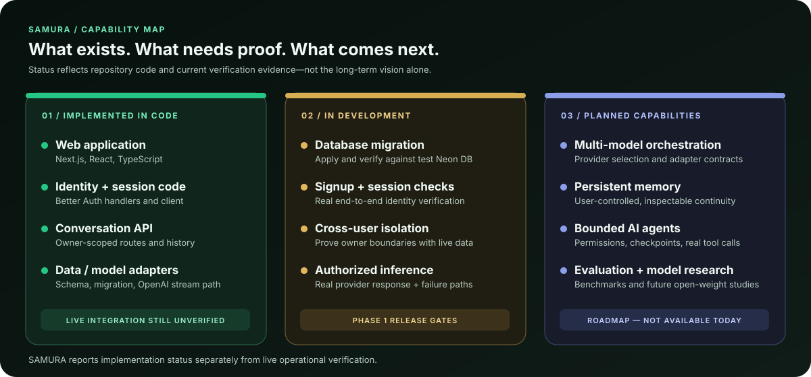
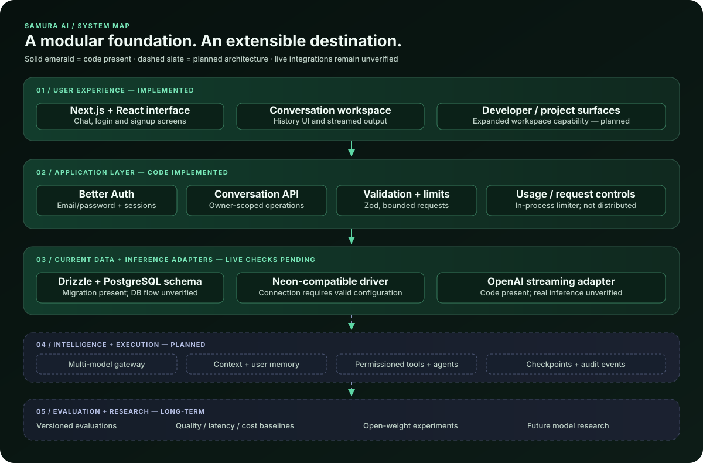
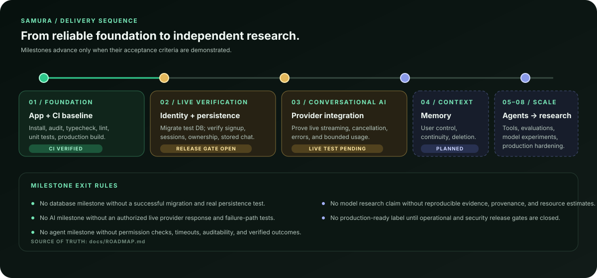

### BUILD USEFUL INTELLIGENCE. EARN TRUST. GROW CAPABILITY.

**An independent AI engineering initiative building toward persistent conversational intelligence, multi-model orchestration, bounded agents, and long-horizon model research.**

[Explore the roadmap](docs/ROADMAP.md) · [Read the architecture](docs/ARCHITECTURE.md) · [Security baseline](docs/SECURITY.md) · [Contributing](CONTRIBUTING.md)

 

---

> **The ambition is independent intelligence. The method is evidence.**
>
> SAMURA is named in honor of the founder's mother. The project starts with a dependable application foundation and aims to earn each next capability through engineering, evaluation, and responsible research.

## At a glance

| | Current position |
|---|---|
| **Project stage** | Foundation / Phase 1 |
| **Application** | Next.js App Router + React + TypeScript |
| **Persistence layer** | PostgreSQL schema and migration via Drizzle; Neon-compatible driver |
| **Identity** | Better Auth email/password implementation |
| **Model interface** | Server-side OpenAI streaming adapter implemented; live inference not yet verified |
| **Verification** | CI covers dependency audit, typecheck, lint, unit tests, and production build |
| **Release posture** | Early development — not production-ready |

**Important:** code being present is not the same as a live integration being verified. Live database migration, signup/session behavior, cross-user isolation, and real provider inference remain release gates. See [Phase 1 status](docs/PHASE-1.md) and the [security baseline](docs/SECURITY.md).

## Why SAMURA exists

AI products should become more useful without becoming opaque, unaccountable, or permanently dependent on a single provider. SAMURA's long-term direction is to move progressively from an accessible AI application toward a modular intelligence platform whose context, tools, evaluations, and research workflows can be understood and improved.

That is a direction, not a claim that SAMURA currently trains foundation models. Integrating a third-party model, running an open-weight model, adapting a model, and training a model from scratch are different technical and resource commitments. We will label them accurately.

## Principles that shape the work

- **Evidence over theatre** — report capabilities only at the level supported by code and tests.
- **Progressive independence** — build useful infrastructure first; expand ownership of the stack as capability and resources allow.
- **User-controlled continuity** — design persistent context and memory so people can inspect and manage what is retained.
- **Real execution, bounded authority** — future agents must use explicit permissions, timeouts, checkpoints, and verifiable completion criteria.
- **Security as architecture** — authorize every private operation server-side, scope data by owner, and protect secrets.
- **Provider flexibility** — keep model-specific behavior behind explicit adapters rather than implying every model is interchangeable.
- **Resource-aware research** — measure cost, latency, quality, compute, and licensing constraints before scaling experiments.
- **Transparent limitations** — make unfinished work and release blockers visible.

## Capability map

The graphic separates implementation from ambition. The foundation branch currently contains the web application, authentication and conversation code, database schema/migration, and a server-side provider adapter. Real infrastructure checks remain outstanding; memory, agents, multi-provider orchestration, evaluation infrastructure, and proprietary model research are roadmap items.

## Architecture: today and the intended direction

SAMURA currently follows a **modular-monolith direction**: the Next.js application contains the user experience and server routes; Better Auth handles identity; Drizzle models PostgreSQL persistence; and an OpenAI adapter is implemented for server-side streaming. The Neon-compatible driver and migration are present, but a successful live database flow has not yet been demonstrated.

The model gateway, durable memory, permissioned agent runtime, evaluation services, and model research layer are architectural objectives—not deployed services today.

See [Architecture and trust boundaries](docs/ARCHITECTURE.md).

## Technology stack

| Area | Current repository evidence | Status |
|---|---|---|
| Web application | Next.js App Router, React, TypeScript | Implemented |
| UI and styling | Tailwind CSS v4, Lucide icons, responsive application styles | Implemented |
| Input validation | Zod | Used in server request handling |
| Identity | Better Auth email/password handlers and browser client | Code implemented; live flow unverified |
| Data access | Drizzle ORM, Neon serverless driver, PostgreSQL schema and SQL migration | Code implemented; live migration unverified |
| Model adapter | OpenAI SDK, server-side streaming path | Code implemented; live inference unverified |
| Conversation rendering | React Markdown + GitHub Flavored Markdown | Implemented |
| Verification | Vitest, ESLint, TypeScript, GitHub Actions | Configured; see live workflow for current result |
| Hosting | Vercel preview deployment exists | Preview deployed; production readiness not established |
| Multi-provider routing, durable memory, agents, model research | Roadmap | Planned |

## Roadmap

| Milestone | Status | Exit criteria |
|---|---|---|
| Foundation and automated verification | **Implemented / verified in CI** | Reproducible install, dependency audit, typecheck, lint, tests, production build |
| Authentication and persistent storage | **In development — live verification pending** | Apply migration to a test database; verify signup, login, sessions, ownership isolation, and persistence |
| Conversational AI integration | **Adapter implemented — live verification pending** | Successful authorized inference, streaming/cancellation tests, safe failure paths, usage limits |
| Context and user-controlled memory | **Planned** | Memory create/read/update/delete, explicit user controls, deletion tests, bounded context |
| Bounded agent runtime | **Planned** | Typed tool permissions, timeouts, checkpoints, idempotency, approvals, audited outcomes |
| Evaluation and economics | **Planned** | Versioned evaluations plus quality, latency, and cost baselines |
| Open-weight experimentation and model research | **Long-term research** | Reproducible experiments, provenance/licence checks, compute budget, published methodology |
| Production hardening and developer services | **Not ready** | Shared rate limiting, recovery/verification flows, operational controls, security review, deployment validation |

The canonical checklist lives in [docs/ROADMAP.md](docs/ROADMAP.md). Phase 1 remains open until its live integration gates are satisfied.

## Feature status

| Capability | Status |
|---|---|
| Responsive application and login/signup screens | **Implemented** |
| Health endpoint and automated health test | **Implemented / tested** |
| Email/password authentication handlers | **Implemented; live database flow unverified** |
| Owner-scoped conversation APIs | **Implemented; cross-user integration test pending** |
| Persistent conversation schema and migration | **Implemented; migration not yet verified against live database** |
| Server-side OpenAI streaming adapter | **Implemented; real inference unverified** |
| Markdown/GFM conversation rendering | **Implemented** |
| Shared, distributed rate limiting | **Planned** |
| Email verification and password recovery | **Planned / infrastructure-dependent** |
| Durable cross-project memory | **Planned** |
| Permissioned autonomous agents | **Planned** |
| Multi-provider orchestration | **Planned** |
| Proprietary model training | **Long-term research; not implemented** |

## Security and trust

Security controls already represented in the Phase 1 code include server-side identity checks on private routes, owner-scoped conversation queries, schema validation, server-only provider-key access, bounded prompt/output settings, parameterized database access, and Markdown rendering without raw HTML.

Known gaps are equally important: rate limiting is process-local, email recovery/verification is not enabled, and live database/provider behavior plus tenant isolation are not yet verified. Production cookie/domain behavior, request-size limits at the hosting layer, data export/deletion workflows, and operational secret rotation also need work.

Read [docs/SECURITY.md](docs/SECURITY.md). Please do not send credentials or sensitive vulnerability details through public issues.

## Get started locally

### Prerequisites

- Node.js **22 or newer**
- npm **10.9.9** (the repository declares npm@10.9.9)
- A PostgreSQL connection string for database-backed flows
- An authorized OpenAI API key for live model responses

### Setup

~~~~bash
git clone https://github.com/Olori24/SAMURA.git
cd SAMURA
npm ci
cp .env.example .env.local
~~~~

Fill the required values in .env.local locally. Never commit it or share secret values in logs, screenshots, issues, or pull requests.

~~~~bash
npm run dev
~~~~

Open [http://localhost:3000](http://localhost:3000).

### Verification commands

~~~~bash
npm run typecheck
npm run lint
npm test
npm run build
npm run db:generate
npm run db:migrate
~~~~

Review the generated SQL and confirm the target database before applying migrations. The migration command requires a correctly configured database URL; do not run it against production casually.

### Environment variables

See [.env.example](.env.example) for the repository's actual variable names:

- SAMURA_DATABASE_URL — PostgreSQL connection string.
- BETTER_AUTH_SECRET — random secret, at least 32 characters.
- BETTER_AUTH_URL — canonical app origin.
- OPENAI_API_KEY — server-only provider credential.
- SAMURA_OPENAI_MODEL and SAMURA_MAX_* — optional model and request limits.

Never prefix private keys with NEXT_PUBLIC_.

## Repository map

~~~~text
.
├── .github/
│   └── workflows/          # CI and lockfile maintenance
├── assets/
│   ├── brand/              # Original SAMURA identity
│   ├── diagrams/           # Architecture visuals
│   └── visuals/            # Capability and roadmap visuals
├── docs/
│   ├── ARCHITECTURE.md     # Application boundaries and trust model
│   ├── PHASE-1.md          # Phase 1 implementation and release gates
│   ├── ROADMAP.md          # Milestones and acceptance criteria
│   └── SECURITY.md         # Controls, gaps, and security expectations
├── drizzle/                # PostgreSQL migration and journal
├── src/
│   ├── app/                # Pages, UI, and server API routes
│   ├── db/                 # Drizzle schema and database client
│   └── lib/                # Auth, runtime config, validation/rate limits
├── .env.example            # Safe environment-variable template
├── package.json            # Scripts and dependencies
└── vitest.config.ts        # Test configuration
~~~~

This map highlights the principal paths; consult the repository tree for every file.

## Contributing

SAMURA is early-stage, and careful, focused contributions are welcome. Start with [CONTRIBUTING.md](CONTRIBUTING.md), review the [roadmap](docs/ROADMAP.md), and look at existing issues before proposing a large change.

The expected workflow is:

**INSPECT → PLAN → IMPLEMENT → TEST → FIX → VERIFY → DOCUMENT**

Please include tests for behavior changes, update docs when reality changes, explain what you verified, and avoid unrelated refactors. Security-sensitive changes should be reported privately as described in [docs/SECURITY.md](docs/SECURITY.md). See [repository governance](docs/REPOSITORY-GOVERNANCE.md) for the proposed issue-label taxonomy.

## License

**No license file is currently present in this repository.** Until the project owner establishes a license, do not assume permission to reuse, redistribute, or create derivative works from this code.

## Follow the work

SAMURA is an ambition measured by what can be demonstrated—not by how futuristic a README sounds. Explore the architecture, inspect the roadmap, report issues, and follow the engineering as each capability moves from intention to evidence.

**SAMURA AI · Building toward independent intelligence.**

Useful systems first. Trust at every layer. Research earned through proof.

